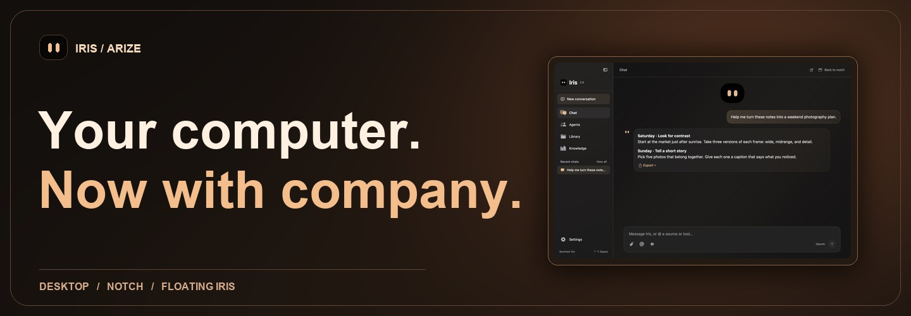
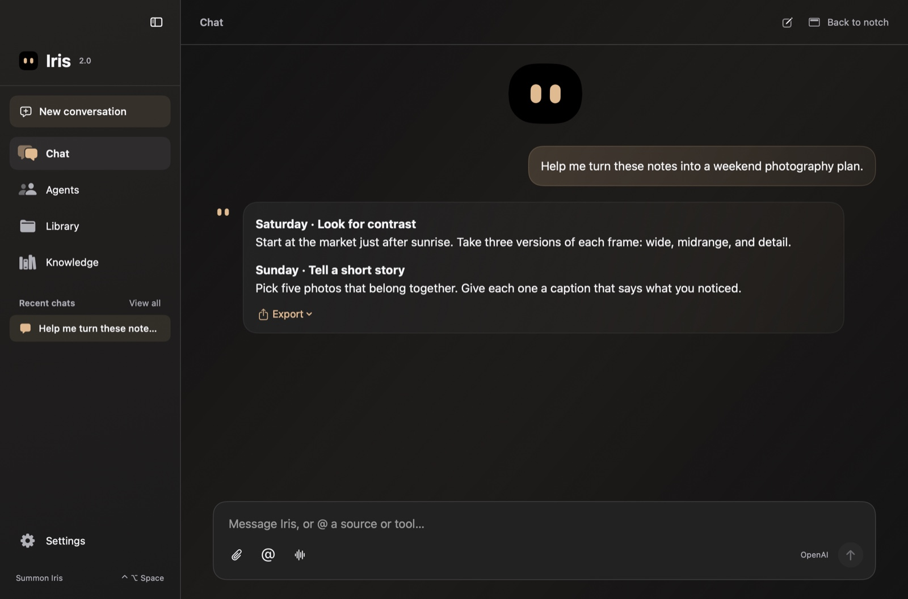
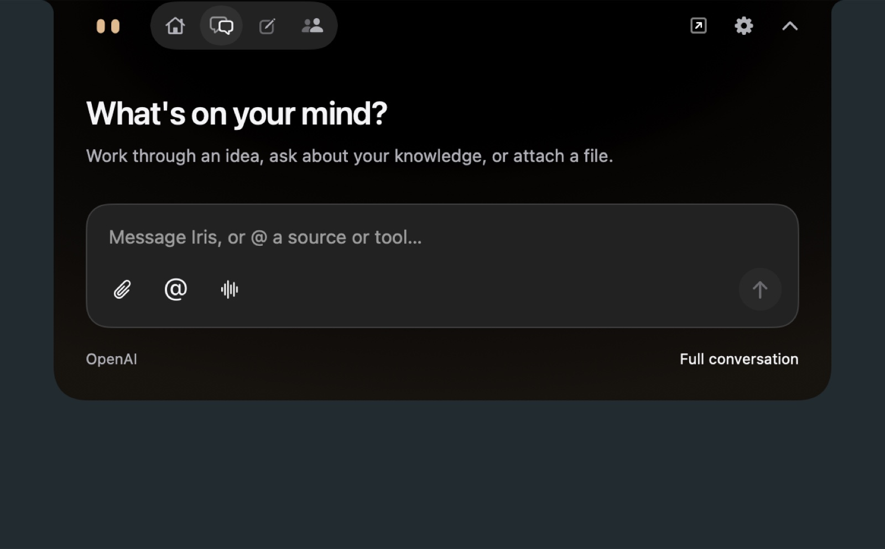
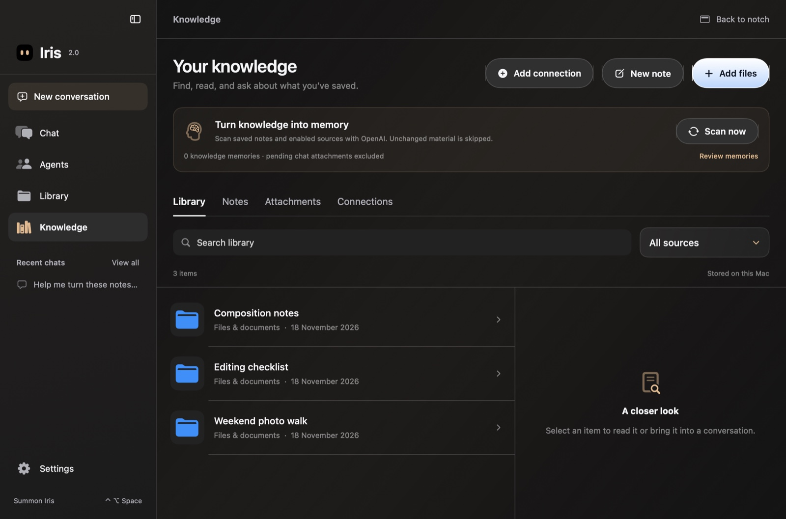

<h1 align="center">Iris</h1>

<p align="center">An AI assistant you can talk to, type to, or bring alongside your work.</p>

<p align="center">
  <a href="https://projectiris.lovelyabbey.chatgpt.site/download"><strong>Download Iris</strong></a> ·
  <a href="https://projectiris.lovelyabbey.chatgpt.site/#features">See it in action</a> ·
  <a href="https://projectiris.lovelyabbey.chatgpt.site/releases">Release notes</a> ·
  <a href="https://github.com/MustafaS22/Project-Iris-Website">Website source</a>
</p>

## Meet Iris

Open the desktop chat for a longer conversation, ask a quick question from the Mac notch, or bring Floating Iris beside the app you’re working in. With screen access and a supported vision model, Iris can point to controls, walk through a diagram, or sketch an explanation.



| A quick question from the notch | Your sources, organized in Knowledge |
| :---: | :---: |
|  |  |

## What you can do

| Feature | Try it |
| --- | --- |
| **Chat and voice** | Speak or type, attach a file, and pick up the conversation later. |
| **Screen guidance** | Ask Floating Iris to show you where to click or explain something on screen. |
| **Double Tap drafting** | Start a reply or polish text in the field you’re already using, then review it before sending. |
| **Knowledge and memory** | Add files, notes, or connections. Type `@` to bring a specific source into chat. |
| **Create and revisit** | Ask Iris to make a website, document, or image. Reopen saved work from the Library. |
| **Computer use & MCP** | Type `@computer` for a supervised multi-step task. Connect trusted tools in Settings → MCP connections; pause or stop from chat/the notch. [Setup and privacy](macOS/Documentation/ComputerUse/Setup.md). |
| **Background agents** | Give a longer job to a specialist and follow its progress while you work. |

## Get Iris

| Platform | Availability |
| --- | --- |
| **macOS** | The main app for Apple Silicon Macs running macOS 15 or later. New versions are available in **Settings → Updates**. [Download for Mac](https://projectiris.lovelyabbey.chatgpt.site/download?platform=macos) |
| **iPhone** | A separate companion preview for iOS 18 or later. [Installation guide](https://projectiris.lovelyabbey.chatgpt.site/iphone) · [Source](iOS/) |
| **Windows** | An unsigned 1.0 test edition with a smaller feature set. [Download and details](https://projectiris.lovelyabbey.chatgpt.site/windows) · [Source](windows/) |

On Mac, open the DMG, drag Iris to Applications, and launch it from there. Onboarding walks through choosing your AI and voice providers, granting the permissions you want to use, and trying the notch, floating mode, and drafting.

### Default voice

Iris uses Fish Audio as its **Default** voice provider in **Settings → Voice & speech**. Select Default and press **Preview voice** to try Simonne, the shared Iris voice. Users can speak with her without entering an API key. Replies can stream as Iris writes, and **Stop** cancels playback.

Simonne requires an internet connection. Reply text passes through AriZe’s voice service to Fish Audio. The service uses the free speech model, with shared request limits and availability governed by Fish Audio. The API key is held in server secret settings. The app source contains the client integration and public service address. Gemini and VoiceBox remain selectable. Older macOS-voice selections use Default.

## Build and test

Open the [Mac Xcode project](macOS/Project%20IRIS.xcodeproj) in Xcode 27.2 or later and choose your Apple signing team. Xcode resolves Sparkle and the official MCP Swift SDK through Swift Package Manager.

```sh
swift test --package-path macOS/IrisCoreTests
swift test --package-path iOS/Tests
(cd windows && npm ci && npm test)
```

For Google sign-in, copy the [example OAuth configuration](macOS/Configuration/GoogleOAuth.example.json) to `macOS/Project IRIS/GoogleOAuth.json` and use your own registered desktop client. Provider credentials, signing keys, and personal chat and knowledge data are excluded from the repository.

## Project links

[Report an app issue](https://github.com/MustafaS22/Project-Iris/issues) · [Privacy](https://projectiris.lovelyabbey.chatgpt.site/privacy) · [Source manifest](SOURCE_MANIFEST.json) · [Release tooling](tools/)

Built by **AriZe**. Third-party assets and dependencies retain their own terms. This repository carries no additional blanket license.
